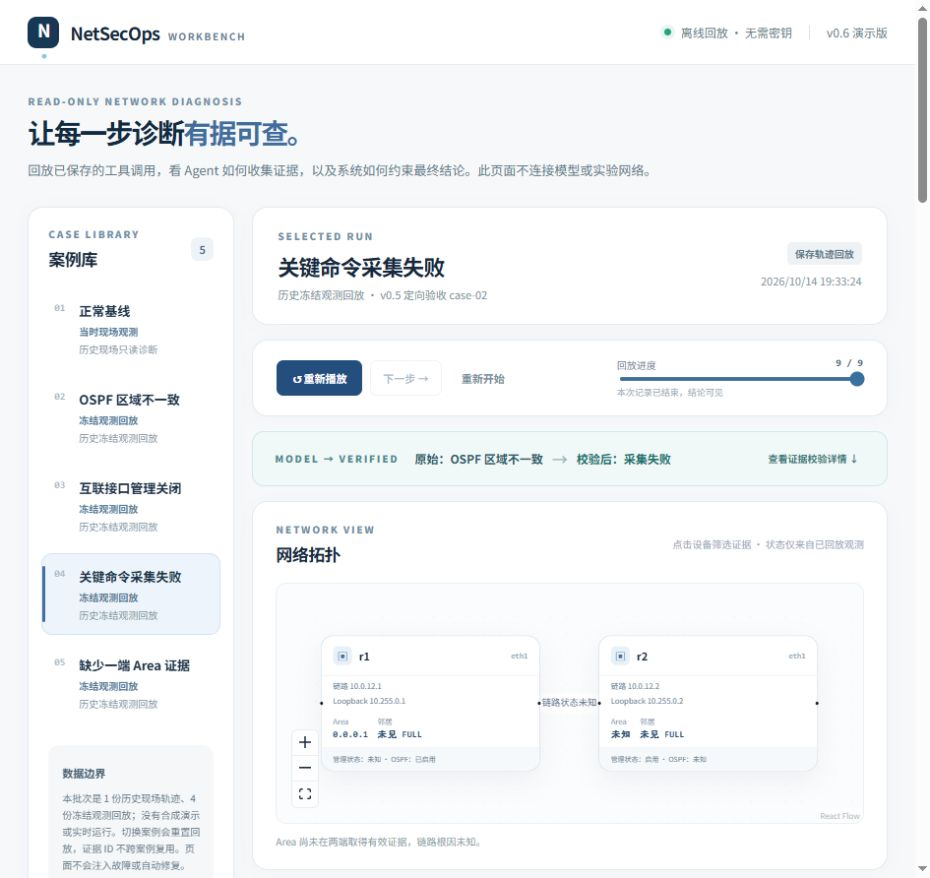

# NetSecOps Agent

[](https://github.com/Lux8510/netsecops-agent/actions/workflows/offline.yml)


**一个"结论必须能追溯到原始命令输出"的只读网络故障诊断 Agent。**

模型可以猜错，但系统不允许它说没有证据的话：每次工具调用都保存原始 stdout/stderr 和运行内 `evidence_id`，确定性校验层再核对根因是否被直接证据支持，不满足就降级为"证据不足"或"采集失败"。

> 定位：受控实验环境下的研究型原型。不是生产网络运维系统，不是自动修复工具。



## 能做什么

- 在 Containerlab + FRRouting 搭的 OSPF 实验网里，让 Agent 自主选择**只读**检查
- 覆盖根因：OSPF 区域不一致、接口管理关闭、接口 passive、采集失败、证据不足
- 保存完整轨迹：模型原始输出、工具调用、证据引用、校验层改动
- 网页工作台回放轨迹，逐条对照原始命令输出
- 离线评测：不需要 Docker、不需要 API Key

## 不能做什么

- 不连接生产设备，不覆盖多故障叠加、非 OSPF 协议
- 没有统计意义上的通用准确率结论（样本为受控实验）
- 不执行任何配置写入；"修复建议"只是文本
- 不提供投注、攻击或其他领域能力

## 快速开始（无需密钥、无需 Docker）

需要 Python 3.12 和 Node.js 22。

```bash
make demo          # 安装前端依赖并启动回放工作台
# 打开 http://127.0.0.1:5173/
```

网页默认只读取 `examples/` 里 5 份经过审查的保存轨迹，不调用模型、不执行命令。

```bash
make test          # 离线全量：核心 Agent 套件 + v1 拓扑套件
make web           # 前端类型检查、单元测试、生产构建
make publish-check # 检查示例/文档中的凭据、本机路径与失效链接
```

`make test` 要求一个装好 `requirements-progress.txt` 的 Python 3.12 环境：

```bash
python3.12 -m venv .venv
.venv/bin/python -m pip install -r requirements-progress.txt
.venv/bin/python -B run_offline_tests.py
```

## 设计要点

### 1. 工具白名单，不接受任意命令

`labs/ospf-baseline/agent_tools.py` 用 `TOOL_ARGUMENTS` 定义 7 个只读工具：

| 工具 | 约束 |
| --- | --- |
| `query_topology()` | 无参数 |
| `query_interface(node, interface)` | 节点限实验网内，接口来自拓扑 |
| `query_interface_config(node, interface)` | 同上 |
| `query_ospf_interface(node, interface)` | 同上 |
| `query_neighbors(node)` | 节点白名单 |
| `query_routes(node, scope)` | `scope` 只能是 `all` / `ospf` |
| `ping_address(node, target)` | 目标限对端互联或 Loopback |

底层只执行 `command_argv()` 里的固定命令模板，没有 shell，没有配置命令。

### 2. 根因必须由直接证据支撑

| 结论 | 必需证据 |
| --- | --- |
| 区域不一致 | 两端互联接口各自有效、Area 不同的原始输出 |
| 接口关闭 | 故障节点接口的 FRR 管理状态 |
| passive | 故障接口作用域内有效的运行配置 |
| 正常 | 两端 Area 相同、双向 FULL、远端路由、双向 ping |

邻居消失、路由缺失、ping 失败只是症状，不能直接当根因。关键命令真实失败时判为 `collection_failure`，不依赖模型是否引用失败 ID。

### 3. 校验层保留差异，不粉饰模型

`validate_final()` 会补入本轮已取得且验证过、但模型漏引的证据，并记录：

- `model_raw_final`：模型原始结论
- `final`：校验后结论
- `evidence_additions`：补引了哪些证据
- `guardrail_changes`：改了哪条判定

### 4. 独立判分器

`judge_agent_trace.py` 在诊断结束后核对：API 工具调用与实际执行是否一致、证据 ID 与原内容、根因位置、修复对象、限制声明与 token 汇总。判分器不参与生成。

## 架构

```text
Containerlab + FRR 实验网
        │  固定只读命令
        ▼
采集器 collect_evidence.py ──► observations.json（原始输出 + 时间 + 退出码）
        │
        ├─► LiveBackend（现场执行）──┐
        └─► ReplayBackend（回放）────┤
                                     ▼
                     Agent 循环（DeepSeek tool_calls，8 轮 / 12 次工具调用预算）
                                     │
                                     ▼
                     证据校验层 evidence_checks.py + validate_final()
                                     │
                                     ▼
                    独立判分器 judge_agent_trace.py
                                     │
                                     ▼
              React 回放工作台（trace.ts schema 校验 + 时间线）
```

## 验证现状

| 项目 | 结果 | 说明 |
| --- | --- | --- |
| 核心 Agent 套件 | 159 项，1 跳过 | 干净临时副本，无 `.env` / 历史运行 |
| v1 拓扑套件 | 26 项 | 6 节点拓扑意图、授权范围、候选路径 |
| 离线全量 | **185 项** | `run_offline_tests.py` 一次跑完两套 |
| 前端 | 7 项 + 类型检查 + 构建 | `npm run check` |
| 保存轨迹 | 5 份 | 正常、采集失败、缺 Area、区域不一致、管理关闭 |

跳过的 1 项是 POSIX SIGTERM 测试，在 Linux 上执行。

本次仓库收敛的实际运行记录见 [v1 收敛验证](docs/VALIDATION_v1-convergence.md)；真实模型调用与现场网络结果按版本记录在 [v0.6](docs/VALIDATION_v0.6.md)、[v0.7](docs/VALIDATION_v0.7.md)，历史记录不跨版本混算。

## 故障注入与模拟修复

两条新增能力，仍然只在实验网内、仍然只读诊断：

- **故障注入矩阵**：`normal / area_mismatch / admin_down / ospf_passive` 四类场景，输出根因准确率、证据覆盖率、虚假置信率、弃权率。离线评估读已保存轨迹，现场矩阵需要 Linux/WSL2 + Docker + DeepSeek Key。
- **模拟修复**：诊断 → 固定命令修复 → 重新诊断 → 无论成败都回滚；只有三种可修复状态，命令白名单 + 双重确认。
- **语义证据校验**：不只看“引用了哪个工具”，还解析输出里的 Area、邻居数、管理状态与 passive，确认结论真的被证据支持。
- **不可信输出**：扫描配置/banner 中的提示注入；超长输出保留头尾并标记截断。
- **歧义保护**：同时存在两个直接故障时输出“证据不足”，不猜单一根因。
- **统计与预算**：Wilson 95% 区间、小样本标记、失败样例清单；A/B 对比 token 与耗时预算。
- **交接给 netcfg-evidence**：导出带哈希的证据包，由 netcfg 用自己的规则复算后创建变更单。

```bash
make matrix     # 离线评估 4 条样例轨迹（无需 Docker/密钥）
NETSECOPS_LIVE_MATRIX=1 python labs/ospf-baseline/experiment_matrix.py --live --runs 3
NETSECOPS_LAB_SIMULATION=1 python labs/ospf-baseline/simulate_fix.py --target r2 --confirm-lab
python labs/ospf-baseline/handoff.py --trace trace.json --device r2 --target r2 --out handoff.json
python labs/ospf-baseline/ab_compare.py --variant chat=chat/manifest.json --variant reasoner=reasoner/manifest.json
```

设计、指标定义与安全约束见 [docs/EXPERIMENTS.md](docs/EXPERIMENTS.md)。现场矩阵与真实模拟修复尚未在 CI 执行。2026-11-19 两轮审查修正见 [docs/REVIEW_FIXES_2026-11-19.md](docs/REVIEW_FIXES_2026-11-19.md)。

## 目录

```text
labs/ospf-baseline/   Agent 循环、工具层、采集器、证据校验、判分器、事件服务
v1/                   六节点拓扑意图、授权范围、候选路径、真实基线采集
web/                  React 回放工作台
examples/             5 份经过审查的可发布轨迹
docs/                 项目概览、演示脚本、面试问答、验证记录
history/              v0.1–v0.5 审查材料与历史日志（只读归档）
tools/                发布检查与示例导出
```

## 进一步阅读

- [项目概览](docs/PROJECT_OVERVIEW.md)：信任边界与能力范围
- [演示脚本](docs/DEMO_SCRIPT.md)：3 分钟演示流程
- [面试问答](docs/INTERVIEW_QA.md)：设计取舍与追问
- [v1 拓扑说明](v1/README.md)：六节点实验与授权范围
- [取舍记录](DECISIONS.md)：本次收敛的理由

## 许可与数据

示例轨迹为受控实验的脱敏副本，不含密钥、真实设备信息或个人路径。运行时如需调用模型，请自行在本地 `.env` 配置 `DEEPSEEK_API_KEY`，密钥不会进入仓库。
